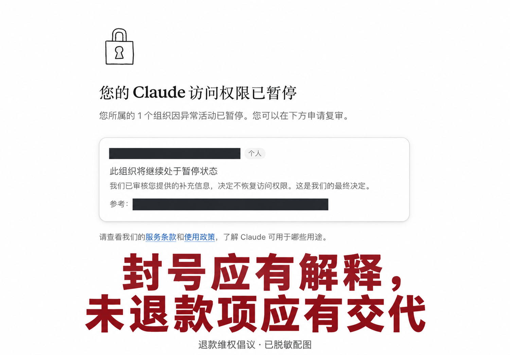

# 封号应有解释，未退款项应有交代 这是一个压力测试，建议所有被封号没有退款的用户24小时运行程序

**致 Claude / Anthropic：请正面回应用户的退款诉求。**



> 配图基于发起者提供的暂停访问截图制作，已遮盖邮箱和申诉编号，并添加倡议文字；它是经过编辑的宣传配图，不是原始凭证。截图显示访问权限暂停及复审后不恢复访问的通知，本身不能证明付款金额、余额或退款状态。未获退款的情况为发起者陈述，应以原始付款记录、余额记录和客服往来补充核实。

```python
crontab -e
* * * * * /usr/bin/flock -n /run/dosome.lock /usr/bin/python3 /root/claude_load_test.py --key-file /etc/claude.txt --output /root/report.json >> /root/dosome.log 2>&1

python claude_load_test.py
  --key-file /etc/key.txt
  --output report.json
```

## 我们要求一个说得清楚的答复

付费之后，访问被暂停；提出申诉之后，收到“不恢复访问”的结果。对于仍有未退款项的用户，事情不能到这里就结束。

我们反对用一句“最终决定”代替对资金问题的说明。账号的处理结果，不能成为回避退款问题的理由。用户需要知道：钱去了哪里，剩余款项如何核对，能否退还，何时收到答复。

**我们要求解释，要求逐项对账，要求对未退款项作出明确处理。**

1. **说明封禁与复审结果。** 在不泄露安全检测细节的前提下，给出用户能够理解的原因、相关条款，以及是否还有纠错渠道。
2. **核对资金。** 对用户提出的订阅未使用部分、预充值余额或其他争议款项，逐项说明金额、使用情况和处理结论，不把不同款项混为一谈。
3. **正面回复退款申请。** 可以退还的，说明金额、原支付渠道和预计时间；决定不退的，说明具体依据和款项计算方式。
4. **给出可追踪的处理进度。** 提供工单与明确答复，让用户知道问题由谁受理、还缺什么材料、何时获得下一次回复。

这些是我们的诉求；每笔款项是否可退、如何处理，需要结合实际交易记录与适用规则逐笔核对。

## 把愤怒变成记录，把诉求写成问题

如果你也遇到访问被暂停、仍有未解决的退款问题，请用自己的真实经历发声。不要让一句笼统的回复淹没具体的金额、时间和请求。

### 第一步：保存原始证据

在本地保存付款凭证、购买时间、服务期限、余额与用量记录、暂停通知、申诉经过和客服回复。按时间顺序整理，保留未经编辑的原件；公开展示时另做脱敏副本。

### 第二步：提交一份完整的退款申请

通过服务商的正式客服或账单支持渠道提交材料。把账号处理申诉和退款问题分别写清楚，请客服逐项回答。可以参考下方模板，删掉不符合自己实际情况的内容。

```text
主题：访问暂停后的款项核对与退款申请

您好：

我的账号于［日期］被暂停访问，相关申诉于［日期］收到［结果］。
我于［日期］支付［金额及币种］，购买了［订阅／预充值等实际项目］。
截至［日期］，我认为仍未解决的款项为［金额及计算依据］。

请协助核对并书面回复：
1. 上述付款、用量与剩余款项的明细；
2. 是否可以退款，以及对应金额与计算方式；
3. 如可以退款，退款渠道及预计到账时间；
4. 如拒绝退款，请说明针对该笔款项的具体依据；
5. 本次申请的工单编号、尚需补充的材料及预计回复时间。

附件：付款凭证、相关余额或用量记录、暂停通知与客服往来。
请通过原有私密客服渠道处理我的个人资料。

谢谢。
```

### 第三步：公开事实与处理进展

分享可核验的时间线和已脱敏的回复，区分自己的经历、推测与尚待核实的信息。记录的不只是“没有收到退款”，也包括对方是否回复、给出什么理由、后来是否解决。

如选择继续向支付渠道或适用的消费者投诉渠道反映，请提交真实、完整的交易与沟通材料，并按对应流程办理。

## 一起发声，也一起保护个人信息

本仓库用于发布退款维权文案与配图。你可以转发这份倡议，或在 Issues 中补充自己的**脱敏经历摘要**：服务类型、付款与暂停日期、争议金额、申请日期、回复及当前处理状态。

不要公开邮箱、申诉编号、完整订单号、银行卡信息、身份证明或 API Key；原始凭证只交给有必要接收材料的正式渠道。无需向本仓库提供任何密钥、登录信息或原始账单。

我们倡议有事实、有记录的公开表达与正式申诉，不组织接口冲击、刷屏、骚扰或泄露他人隐私。

**封号应有解释，未退款项应有交代。**

请让每一份退款申请得到具体答复，让每一笔有争议的款项有据可查，让用户的声音得到认真对待。
